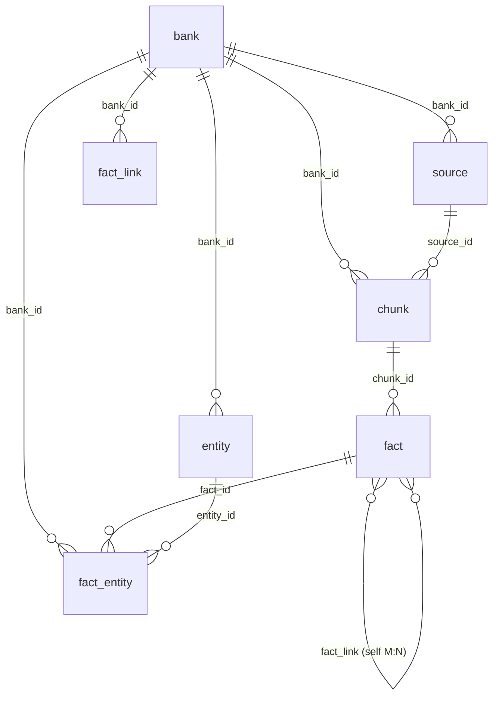

# memorybank Logical Schema Design (Backend-Agnostic)

Based on `docs/hindsight.pdf` (the HINDSIGHT technical report). The goal is to implement the paper's four-network memory model on multiple backends (relational, embedded, hybrid). This document therefore defines only the **logical schema** and its constraints; it is not bound to any specific database's physical types.

## 0. Overall Design Decisions

1. **All four networks live in one `fact` table.** In the paper, the memory graph G=(V,E) has V = "all memory units across the four networks" — opinion and observation are graph nodes too (they carry embeddings, participate in link construction and recall; opinion reinforcement computes sim(v_o, v_f)). Splitting by network would duplicate link-building and recall logic. A `fact_type` column distinguishes them, with conditional constraints for network-specific fields.
2. **Embeddings are inline on the `fact` row** (a single `embedding` column; no separate `memory_embedding` table). Principle: **contracts carry data, not indexes** — BM25/GIN/interval indexes never entered the data contract, and neither do vectors. Every fact always has an embedding (nullable = pending generation/backfill); backend differences concern only **acceleration** (native ANN index / in-row BLOB with brute-force cosine / adapter-internal side table or external vector store), all of which are adapter implementation freedom invisible to the core. Each bank assumes a **single embedding generation**: the active model is runtime configuration, not schema. Switching models is a generation cutover: null out all vectors, then backfill with the new model (see the linkage rule in §3.4).
3. **Temporal fields follow the paper's bi-temporal semantics**: τs/τe (occurrence interval, nullable) and τm (mention time) are stored separately.
4. **`fact_link` materializes only edges that require precomputation or LLM judgment; adjacency derivable from other structures is not stored as edges.** Entity adjacency is the pairwise closure of `fact_entity` bindings — pure materialization, O(n²) for high-degree entities, and every mutation path (re-extraction / entity merge / forgetting) would need to sync it — so traversal derives it from bindings at query time. In-table: `temporal` is undirected and stored as two rows (symmetric predicate: interval proximity; reciprocal rows are written in pairs and pruned in pairs; the canonical-key group count is always 2 — a database-level invariant); `semantic`/`causal` are directed single rows — semantic direction comes from each fact's own top-k neighbor budget (similarity is symmetric, selection is not), while causal follows the causal direction. Direction semantics are derived from `link_type`; there is no direction column.
5. **Traceability is a first-class requirement** (the paper repeatedly emphasizes traceability/audit): the chain is `source (canonical full text + metadata) → chunk (lossless slices) → fact (interpretation layer)`. Observation regeneration is **append-only** (a new batch takes effect on insert; one observation may belong to multiple entities; there is no single-owner notion or replacement set; old batches are reclaimed by runtime GC, and recall prefers recency). Opinion evolution auditing is out of scope for this schema (see §7.C).
6. **Background scheduling is not persisted** (paper §4.1.5 Backend Processing is an async *intent*): work lists for observation synthesis, embedding backfill, and link rebuild are all derived from in-database state — NULL-embedding scans, entity evidence-change comparison (e.g. entity e's latest evidence row has a `created_at` later than its latest observation row → needs regeneration), and in-place semantic-link rebuild during a generation cutover. The scheduler is a runtime component (in-memory queue / periodic sweep); schedules lost on process crash converge via sweep. Chunk extraction retries work the same way (the chunk row persists `status` only).
7. **The retrieval unit is the fact row.** The four recall channels operate on `fact`'s four representations (text/BM25, vector, graph, time). Chunk text does not enter the retrieval surface by default (whether BM25 should extend to `chunk.text` — see §7).
8. **Receive-then-persist (transactional inbox)**: before any processing starts, the source row persists the canonical full text (`payload_text`). From then on, crash recovery for chunking and extraction starts from in-database state and **does not depend on the caller resending**. Note: this is **not a kernel WAL** — there is no append-only log and no incremental replay; recovery = rescanning persisted state + idempotent re-execution (§5.1). Text purge / privacy posture is out of schema scope (§7.C).
9. **Three levels of idempotency**: receive level = payload already persisted (no hash needed); chunk level = `chunk.content_hash` unique index, conflict means skip (material shared across sources belongs to the first arrival; a later source becomes a zero-chunk ledger row); extract level = single-chunk transaction + in-transaction `status` flip, with failures retried by rescan. The `fact` layer **never carries hashes** (LLM-rewritten text is non-deterministic and cannot serve as a dedup key).
10. **Every table carries `bank_id` directly** (including chunk / fact_entity / fact_link): it is the **deletion and partition key** — "delete a bank" = one indexed range delete per table (parallelizable, no FK cascade, since FKs may not exist on non-relational backends), and it enables per-bank sharding and isolation. Redundant derivation, but load-bearing: it meets the "a column must buy an index or constraint" criterion.

## 1. Design Philosophy and Terminology

### 1.1 All Data Is a Generated Layer of Interpretation

`fact` data is, at the end of the day, **LLM-extracted rather than raw**. Every layer is "generated" from the one below:

```
raw utterances (owned by the caller; persisted at source/chunk granularity per policy)
   → LLM extraction → narrative fact (fact.text)      ← first interpretation
   → LLM synthesis  → entity observation              ← second interpretation
   → LLM formation  → opinion + confidence            ← third interpretation
   → LLM assessment → confidence adjustments          ← fourth interpretation
```

Three implications:

1. **The bank holds no raw data; "objectivity" comes from structure and audit, not literal copying.** world rows are rewrites too; their credibility is guaranteed by the provenance chain (fact → chunk → source).
2. **Rewrite ≠ summary.** The extraction prompt (paper A.1) demands MAXIMUM VERBOSITY and omits no detail; at write time it resolves pronouns, normalizes time, and expands references — the retrieval corpus is "augmented text" (e.g. "she" → "Emily (the user's roommate)"), more retrieval-friendly than the raw text. BM25 covers the lexical layer (proper nouns/numbers survive rewriting best), vectors cover semantics, entity adjacency covers "different wording, same identity"; the last fallback for rewrite loss is **an honest empty result → abstention**, rather than hallucinating over noisy context like fixed-top-k RAG.
3. **Rebuild capability depends on retained material**: payload and chunk slices persist with the pipeline, so stored chunks can be re-extracted (crash retry, model-upgrade re-extraction). Text purge is a deployment-level ops job; the schema excludes it (§7.C).

### 1.2 Terminology

| Paper term | This schema |
|---|---|
| memory unit / fact (generic) f = (u, b, t, v, τs, τe, τm, ℓ, c, x) | one row of the `fact` table (**fact row**) |
| fact_type ℓ(f) | the `fact.fact_type` column |
| objective evidence (W, B networks) | rows with fact_type ∈ {world, experience} |
| opinion o = (t, c, τ, b, E) | rows with fact_type=opinion (including `confidence`) |
| observation (entity profile) | rows with fact_type=observation (entity bindings via `fact_entity`, see §3.6) |

Writing discipline: rows and the table are collectively called `fact` / fact row — covering the paper's fact (its memory unit) and all fact_type values. Refer to kinds via fact_type values (world row / experience row / opinion row / observation row). The word "memory" is reserved for domain concepts (agent memory, memory bank, memory graph) and never denotes a row.

### 1.3 Admission Criteria (Table / Field / Edge / Cache)

Any new table, field, edge, or cache must pass these checks:

1. **Scope discipline**: paper mechanisms (§7.A) first; operational necessities (§7.B) in a minimal form; product postures and optimizations (§7.C) deferred — out-of-scope items do not enter the schema and are recorded in §7.C.
2. **Contracts carry data, not indexes or strategies.** Test: does the value vary with **deployment/implementation** rather than with **business facts**? Yes → configuration (runtime/adapter); no → column. Example: embedding model, chunking parameters, retry pacing, link thresholds, ANN acceleration mode all live at runtime; `fact.embedding` data itself lives in the table.
3. **Single source of truth.** Test: can it be derived from other tables/columns with **one indexed query**? Yes → do not store it. Example: entity adjacency = the pairwise closure of `fact_entity` (virtualized, not stored in `fact_link`); mention variants = `mention_text` (no alias cache table).
4. **Admission for materialization/derived redundancy**: it must buy at least one of — (a) an index or unique constraint (e.g. `bank_id` as deletion/partition key, `chunk.content_hash`); (b) significant hot-path cost savings **with a named consumer** (e.g. `entity.mention_count` for retrieval salience or observation staleness); (c) a cross-backend capability. If it buys none → delete it. Reverse test: does deleting it only mean "slightly slower / one extra step"? Yes → delete it.
5. **Explicit tenant and deletion keys**: every table carries `bank_id`; deletion, partitioning, and isolation must not rely on FK cascades or joins — FK semantics are not guaranteed across backends.
6. **LLM output is never an idempotency key**: hashing/dedup only applies to byte-stable layers (payload, slices); generated text (facts, observations, opinions) **never carries a content hash**.

The specific decisions in §0 are **instances** of these criteria; retired constructs and their re-add paths are recorded in §7.C.

## 2. Common Type Conventions

| Logical type | Meaning | Relational mapping example | Embedded / other backends |
|---|---|---|---|
| `Id` | UUIDv7 (time-ordered, good for pagination) | `UUID` | `TEXT` / `BLOB` |
| `TS` | UTC timestamp, millisecond precision | `timestamptz` | `INTEGER` (epoch ms) / `TEXT` |
| `Enum{a,b,c}` | lowercase string enum | `TEXT` + CHECK | `TEXT` / `INTEGER` |
| `JSON` | arbitrary object | `jsonb` | `TEXT` / `BLOB` |
| `Vector<d>` | fixed-size f32 vector, d = configured embedding dimension (`fact.embedding` inline column) | `vector(d)` + optional HNSW | in-row `BLOB` (brute-force cosine) / sqlite-vec / adapter-side store |
| `Float01` | float in [0,1] | `real` + CHECK | `REAL` |

Foreign keys are annotated `→ table.column`. Every table carries `created_at`/`updated_at` (not repeated below; listed explicitly only where the column's semantics need emphasis).

## 3. Table Inventory (7 Core Tables)

### 3.1 `bank` — Memory Bank Container + Agent Profile

**Purpose**: the paper's bank B, a named container holding the four-network data plus an agent profile P = (n, Θ, h). All data is isolated by bank.

| Field | Type | Notes |
|---|---|---|
| `id` | `Id` PK | |
| `name` | `Text` UNIQUE | container name n |
| `background` | `Text` | first-person background h; continuously rewritten by background merging (h' = MergeLLM(h, h_new)) |
| `skepticism` | `Int` 1..5 | Θ.S (1 = trusting, 5 = skeptical) |
| `literalism` | `Int` 1..5 | Θ.L (1 = flexible, 5 = literal) |
| `empathy` | `Int` 1..5 | Θ.E (1 = detached, 5 = empathetic) |
| `bias_strength` | `Float01` | Θ.β (0 = fact-based reasoning, 1 = strongly preference-conditioned) |

### 3.2 `source` — Ingest Ledger + Transactional Inbox (required by the retain pipeline)

**Purpose**: the paper's input D (conversation transcripts / documents). **Receive-then-persist**: the canonical full text is stored before chunking/extraction begins; this is the starting point for all crash recovery. Idempotency hashes do not live here (they are pushed down to chunk).

| Field | Type | Notes |
|---|---|---|
| `id` | `Id` PK | |
| `bank_id` | `Id` → bank.id | |
| `title` | `Text` nullable | |
| `payload_text` | `Text` | canonical full text: the caller payload (transcript JSON / document) converted to canonical text; chunking is a **lossless** split of it. Written by the receive transaction (tx0) |
| `status` | `Enum{received, chunked}` | received = persisted, awaiting chunking (after tx0); chunked = chunking done (chunk rows written or all skipped by hash, after tx1) |
| `created_at` | `TS` | receive time (inbox entry time, written by tx0) — listed explicitly here to anchor "receive-then-persist" |

Index: (bank_id, status) (rescan finds sources awaiting chunking). A client resending the same payload produces a "zero-chunk source row" (ledger residue; semantics in §5.1).

### 3.3 `chunk` — Chunk Slice (core: idempotency unit + transaction unit)

**Purpose**: the consumption unit of the extraction pipeline; a **lossless slice** of `source.payload_text`. It is persisted at ingest time (before extraction) and anchors idempotency and replay: `content_hash` handles cross-source material dedup ("does the bank already have this material?"), while `status` is the extraction progress ledger ("is this material done?"). The **single-chunk transaction** commits all fact products of that chunk atomically (see §5.1).

| Field | Type | Notes |
|---|---|---|
| `id` | `Id` PK | |
| `bank_id` | `Id` → bank.id | tenant/deletion/partition key (§0.10). Must equal source.bank_id |
| `source_id` | `Id` → source.id | owning ingest ledger |
| `chunk_index` | `Int` | position within the source |
| `text` | `Text` | verbatim slice (lossless substring of payload_text) |
| `content_hash` | `Text` | normalized hash of `text` (hash covers text only, not chunk_index). **UNIQUE(bank_id, content_hash)**: conflict = material already in the bank → skip creation; material and derived facts belong to the first source that arrived |
| `status` | `Enum{pending, extracting, done, failed}` | pending = awaiting extraction; extracting = claimed by a worker (claim validity is judged by the row's `updated_at` age; stale claims are reset by rescan); done = tx2 committed; failed = dead-letter state (runtime retry policy gave up; can be reset to pending manually). Retry pacing/backoff/giving up are runtime scheduling policies, **not persisted** |
| `created_at` | `TS` | chunk persistence time (written by tx1) — listed explicitly to anchor the chunk clock (`updated_at` remains implicit per the global convention and is refreshed on claim/status flips) |
| `time_start` / `time_end` | `TS` nullable | conversation-clock interval covered by this chunk (available when the caller provides turn timestamps); facts without their own time may default `mentioned_at` from this |

Chunking strategy (configuration): when the caller provides session/turn metadata, **session alignment first**; plain documents fall back to fixed windows (e.g. 2–4k tokens). Each chunk is coarsely extracted into 2–5 narrative facts (paper §4.1.2). Chunking is deterministic pure-memory code (reading the persisted payload) and can be re-run after any crash. Chunking parameters are runtime configuration and are not persisted (boundary reproduction relies on deployment-side configuration).

### 3.4 `fact` — Fact Row (unified four-network table, core table)

**Purpose**: the paper's memory unit — the fact row — f = (u, b, t, v, τs, τe, τm, ℓ, c, x). Rows of all four networks live here; `fact_type` is the paper's fact_type ℓ(f). Note: the extraction pipeline only produces world/experience/opinion (the enum in paper A.5.1); observation rows can only be produced by the observation synthesis pipeline.

| Field | Type | Notes |
|---|---|---|
| `id` | `Id` PK | u |
| `bank_id` | `Id` → bank.id | b, required; deletion/partition key (§0.10) |
| `fact_type` | `Enum{world, experience, opinion, observation}` | ℓ(f), owning network |
| `text` | `Text` | t, narrative fact text (LLM rewrite). Primary BM25/full-text corpus, content fed to the LLM, reranker input |
| `embedding` | `Vector<d>` nullable | v. NULL = pending generation/backfill: tx2 writes it when available; on failure it is set NULL and backfilled by runtime embedding backfill (`WHERE embedding IS NULL`). The semantic channel skips NULL rows (BM25 still matches — see the lexical-first window in §5.4); **never compare embeddings across models** |
| `chunk_id` | `Id` nullable → chunk.id | provenance: the chunk slice this row was extracted from (always set for retain-produced rows). Verbatim source text lives in chunk/payload and is not duplicated here |
| `occurred_start` | `TS` nullable | τs, occurrence interval start |
| `occurred_end` | `TS` nullable | τe, occurrence interval end (= start for point events; NULL = open interval; both NULL = no temporal information) |
| `mentioned_at` | `TS` nullable | τm, the time the fact was mentioned in conversation. Used for temporal decay edges, entity-resolution temporal proximity, and the "human-readable time prefix" augmentation |
| `confidence` | `Float01` nullable | c, belief strength. See the conditional constraints below |
| `access_count` | `Int` default 0 | x.access_count: incremented on recall hits; observability/tuning |
| `attrs` | `JSON` nullable | remaining x: fact_kind, structured location, and other fields the paper leaves open |

Conditional constraints:

- `fact_type=opinion` and `chunk_id IS NULL` (reflect-produced) ⇒ `confidence` NOT NULL;
- opinion rows produced directly by extraction (`chunk_id` set, i.e. opinions stated in conversation) ⇒ `confidence` may be NULL: the paper gives no extraction-side confidence (A.5.1 has no such field); nullable rows acquire/revise confidence through reinforcement over time (see §7);
- `fact_type=observation` ⇒ no chunks; observation rows have `chunk_id IS NULL`.

> Note: an earlier design stored a `context` column on `fact` with per-row verbatim excerpts; this was rejected because "one chunk yields multiple facts, duplicating the source text per row". Verbatim text now lives uniformly in source/chunk (payload + slices), with `chunk_id` as the replacement.
>
> Embedding linkage rules: if `text` is rewritten (opinion revise, re-extraction replacement) ⇒ that row's embedding becomes invalid and must be re-embedded (in-transaction or runtime backfill). Dimension d and the active embedding model are bank runtime configuration, **neither is a column** — switching models = generation cutover: NULL out all `embedding`, backfill with the new model (`WHERE embedding IS NULL`); rows from the old generation outside backfill/new writes do not participate in the semantic channel; **never compare across models**. After a cutover the semantic channel only covers "newly written + already backfilled" rows (partially available; a missing RRF list contributes 0, correctness intact). Semantic links are rebuilt in place during the cutover (also a runtime concern). Vector byte length is validated against d on write; mismatch is rejected.

### 3.5 `entity` — Canonical Entity

**Purpose**: the canonical entities E produced by entity resolution. The paper defines entity_type ∈ {PERSON, ORGANIZATION, LOCATION, PRODUCT, CONCEPT, OTHER}. Resolution is per bank (bank isolation).

| Field | Type | Notes |
|---|---|---|
| `id` | `Id` PK | |
| `bank_id` | `Id` → bank.id | same isolation boundary as fact |
| `canonical_name` | `Text` | canonical name (lowercased/trimmed before storage). UNIQUE(bank_id, canonical_name) prevents duplicate entities under concurrency |
| `entity_type` | `Enum{person, organization, location, product, concept, other}` | |
| `mention_count` | `Int` default 0 | materialized counter: number of **world/experience bindings** in fact_entity ("how many evidence rows mention it"). Incremented/decremented **in the same transaction** as binding writes/deletes; observation bindings excluded (derived rows drift with append/GC and would self-count), opinion bindings excluded (weak signal). Used as a retrieval salience prior and to estimate the size of Fe |
| `first_seen` / `last_seen` | `TS` nullable | first/most recent time the entity was mentioned by an evidence row. Uses the **conversation clock** (`fact.mentioned_at`, falling back to `fact.created_at`); same scope as mention_count (world/experience bindings) and maintained in the same transaction. Used for entity activity/freshness and observation staleness checks |
| `attrs` | `JSON` nullable | resolution process info (merge history, scores, etc.) |

> Statistics maintenance: binding writes/deletes (A1 extraction commit, re-extraction replacement) update mention_count and first_seen/last_seen in the same transaction; backends without strict transactions may drift, converging via rescan/maintenance jobs.

### 3.6 `fact_entity` — Fact ↔ Entity (N:M)

**Purpose**: the landing place for the paper's extracted canonical entity set E, and the **physical source of entity adjacency**. It underpins four things: ① carrying entity adjacency (the pairwise closure of rows sharing an entity is derived here; `fact_link` does not materialize it; traversal/spreading activation reverse-looks-up bindings); ② retrieving Fe and observation batches by entity during recall; ③ finding opinion reinforcement candidates by entity overlap (O_cand criterion 1); ④ carrying bindings for observation regeneration.

| Field | Type | Notes |
|---|---|---|
| `bank_id` | `Id` → bank.id | tenant/deletion/partition key (§0.10). Must match the bank_id of both endpoints (fact/entity) |
| `fact_id` | `Id` PK(composite) → fact.id | |
| `entity_id` | `Id` PK(composite) → entity.id | |
| `mention_text` | `Text` nullable | the raw mention at extraction time (e.g. "my roommate Emily"); used for resolution features and debugging; **historical mention variants for entity resolution are provided from here** (no alias cache table; see §7.C) |

**Observation binding semantics**: observation rows establish **full bindings** too — the generation-target entity (the entities the observation describes, **possibly several**) and entities mentioned in the text are treated alike, with **no subject/mention distinction** ("which entity owns this profile row" is process information and is not persisted). All bindings are equal in retrieval semantics: all participate in deriving entity adjacency, entity-scoped recall, and reinforcement candidates; newly generated observation batches are preferred in recall by `created_at` recency, and old batches are reclaimed by runtime GC (§5.3, §7).

Indexes in both directions are required: (fact_id) and (entity_id).

### 3.7 `fact_link` — Edges of the Memory Graph

**Purpose**: storage for the memory graph's edges. G=(V,E) conceptually contains four adjacency classes; this table materializes only temporal/semantic/causal — **entity adjacency is not stored here**; it is the pairwise closure of fact_entity bindings, derived during traversal (§3.6). Direction semantics are derived from `link_type`; **there is no direction column**:

| Field | Type | Notes |
|---|---|---|
| `id` | `Id` PK | |
| `bank_id` | `Id` → bank.id | tenant/deletion/partition key (§0.10). Must match the bank_id of both endpoint facts |
| `from_fact_id` | `Id` → fact.id | for directed edges, the initiating side (selection or cause) |
| `to_fact_id` | `Id` → fact.id | |
| `link_type` | `Enum{temporal, semantic, causal}` | edge type ℓ; also determines row shape: **temporal = undirected, two rows**; **semantic/causal = directed, single row** |
| `relation` | `Enum{causes, caused_by, enables, prevents}` nullable | required for causal edges only; direction semantics expressed by relation |
| `weight` | `Float01` | causal = 1.0 (upweighted during traversal by the type multiplier µ(ℓ)); temporal = exp(−Δt/σt); semantic = cosine (edge created only when ≥ θs) |

**Row-shape conventions**:

- **Undirected, two rows (temporal)**: the predicate is symmetric (interval proximity). Store **reciprocal rows** for the same pair — from→to and to→from, inserted in pairs in the same transaction with equal weight. Pruning applies **per pair**: when a pair is pruned, neither row exists, so the invariant "two rows = a complete pair" is checkable in the database (grouping by canonical key (min(from,to), max(from,to), link_type) always yields a count of 2; a one-sided row is an anomaly).
- **Directed, single row (semantic)**: cosine similarity is symmetric, but **top-k selection is not** — each fact selects its own neighbor budget; if B's budget is filled by closer neighbors, sim(A,B)=0.82 may still leave only A→B (B→A absent because B never selected A). The edge therefore means "**A selected B into its own neighbor budget**" and does not claim reciprocity; whether B→A exists is decided by B's own selection. Adjacency reads are always single-direction: `WHERE from_fact_id = N`.
- **Directed, single row (causal)**: cause→effect direction; the causal predicate is expressed by relation.
- **Entity adjacency is not in this table**: adjacency between two facts sharing an entity is derived from `fact_entity` bindings — traversal/spreading activation reverse-looks-up rows sharing the entity; weight is always 1.0 and the µ(entity) rule is unchanged. Materializing the pairwise closure costs O(n²) (dominated by high-degree entities) and would require syncing on every mutation path (re-extraction/merge/forgetting), so it is not stored.
- Re-entry dedup: temporal by canonical key (min(from,to), max(from,to), link_type); semantic/causal by (from, to, link_type) — reciprocal edges (A→B and B→A) are independent rows and may coexist or exist alone.

Unique constraint (from_fact_id, to_fact_id, link_type, relation). Link thresholds (σt, θs, top-k budget, neighbor caps, etc.) are configuration, not persisted — this table stores only the edges "finally decided to keep" (avoiding V² edge counts requires pruning at construction time).

## 4. Table Relationships



Key points:

- **bank is the tenant boundary for all data, and every table carries `bank_id` directly (§0.10)**: "delete a bank" = indexed range deletes per table (parallelizable), not relying on FK cascades; cross-table references (both ends of fact_link, both ends of fact_entity) are validated for same-bank on write. Global convention: `bank_id` is indexed on every table (except bank itself).
- **Three-layer provenance chain**: source (ledger: metadata + canonical full text) → chunk (lossless slice material) → fact (generated interpretation layer). The verbatim text exists twice in the database (payload + slices, ×2), required by the inbox and idempotent replay; fact does not duplicate source text, and `chunk_id` is the only anchor. When a cross-source chunk hash matches, **no duplicate material row is created** — material and derived facts always have a single owner.
- **fact ↔ entity is N:M** (`fact_entity`; many rows per fact on the memory side). Observation rows use the same binding scheme; generation-target and mentioned entities are not distinguished (the subject notion is process information and is not persisted); regeneration is append-only and old batches are reclaimed by runtime GC (§5.3).
- **fact ↔ fact self-reference** has only one group: `fact_link` (graph edges, M:N). Observation regeneration is **append-only** (a new batch takes effect on insert; no version chain; old batches are reclaimed by runtime GC).
- **No opinion-history table**: opinions evolve in place (confidence updates); there is no audit table in this schema (§7.C).

## 5. Data Flow: Writes and Reads

### 5.1 Ingest Pipeline (Four Inbox Stages) and Crash Recovery

```
① tx0 receive: caller payload → canonical text → insert source (payload_text, status=received)
        ── ack may be returned here (async contract) or processing continues synchronously
② chunking (deterministic pure-memory code reading the persisted payload; survives any crash)
   tx1: insert all chunk rows (text + content_hash + status=pending)
        each row ON CONFLICT(bank_id, content_hash) → skip (material already in bank)
        + source.status → chunked (same transaction)
③ per-chunk extraction (synchronous or worker-driven):
   outside the transaction: LLM extraction / Assess / embedding, etc.
   tx2: all fact products of the chunk (fact (embedding written inline) + fact_entity
        + entity + fact_link + confidence deltas on existing opinions) + chunk.status pending→done
        (atomic claim: UPDATE … WHERE status='pending'; zero rows affected ⇒ someone else finished → abort)
④ rescan (startup/periodic):
   source.status=received → re-run chunking (tx1)
   chunk.status=pending, or extracting whose updated_at is stale → re-run ③
   (retry pacing/backoff/giving up (status=failed) is runtime scheduling, not persisted)
```

| Level | Crash point | Recovery | Idempotency guarantee |
|---|---|---|---|
| Receive | before tx0 commits | caller resends (the only irreducible window: the database never received the bytes) | tx0 atomic; on resend, old payload is skipped by hash and a new zero-chunk source row remains |
| Chunking | before/after tx1 | rescan re-chunks | chunk hash unique index; conflict = skip |
| Extraction | outside the transaction (model calls) or during tx2 | chunk stays pending/extracting; rescan re-runs | atomic status claim + whole-transaction rollback; α deltas live inside the transaction and are never applied twice |

**Cross-source shared chunk semantics**: when a later source matches all chunk hashes, it becomes a "zero-chunk source row" (the ledger records "seen"; no duplicate chunk, no copied text, no re-extraction).

**Re-extraction (update mode)**: re-running extraction over stored chunks for scenarios like model upgrades = in-transaction delete of the chunk's old facts and outgoing edges + insert of new facts + status flip. Reinforcement deltas already absorbed into opinions are **not rolled back** (recorded).

### 5.2 Structured Output → Column Mapping (the conversion contract between source and fact)

| ExtractedFact field (paper A.5.1) | Lands in |
|---|---|
| the five dimensions (what/when/where/who/why) woven into one narrative | `fact.text` |
| fact_type | `fact.fact_type` (world/experience/opinion) |
| occurred_start / occurred_end (normalized absolute times) | `fact.occurred_start` / `occurred_end` |
| mentioned_at | `fact.mentioned_at` |
| entities[] (mention list) | `fact_entity` (mention → resolved canonical entity) |
| causal_relations[] (causal relations within the chunk) | `fact_link` (link_type=causal) |

### 5.3 The Five Generation/Update Paths and Their Table Landing Spots

| Path | Trigger | Rows inserted | Rows modified |
|---|---|---|---|
| A0. Receive and chunk (first two inbox stages) | caller ingests D | source(payload), chunk(text+hash, status=pending; hash conflicts skipped) | source.status→chunked |
| A1. Retain extraction (single-chunk transaction; A2/A3 land in the same transaction) | after chunks are persisted (sync or rescan) | fact(world/experience, plus extraction-produced opinions; embedding written inline), fact_entity, entity, fact_link | chunk.status→done; existing opinions' confidence/text |
| A2. Opinion reinforcement | inside A1's transaction (Assess runs outside) | — | fact.confidence (c±α), possibly text |
| A3. Background merge | biographical info encountered during retain (MergeLLM outside the transaction) | — | bank.background |
| B. Reflect opinion formation | query-driven response | fact(opinion, embedding inline), fact_entity | — |
| C. Observation background synthesis | entity touched by new facts (runtime scheduling: in-memory queue or periodic sweep; work list derived from state — e.g. e's latest evidence row is newer than its latest observation row) | fact(observation, embedding inline) + its full fact_entity bindings | — (append-only, no destructive replacement; old batches reclaimed by runtime GC by age/count cap; recall prefers recency) |
| D. Programmatic direct write (undecided, not in paper) | application writes explicitly | depends on API | — |

### 5.4 Read Path (Recall's Four Channels) and Steps That Produce No Facts

| Channel | Data source |
|---|---|
| Semantic (vector) | `fact.embedding` (generated from fact text + human-readable time prefix; ANN indexing is adapter implementation freedom — the core only sees value reads and filtered scans) |
| Keyword (BM25) | `fact.text` (whether to also cover `chunk.text` as a verbatim fallback: see §7) |
| Graph spreading | `fact_link` + `fact_entity` (activation starts from semantic hits; entity adjacency derived from bindings) |
| Temporal filter | `fact.occurred_*` / `mentioned_at` interval matching |

RRF fusion, cross-encoder reranking, and token-budget packing all happen in memory and are not persisted; after a hit, `fact.access_count`++ **Steps that explicitly produce no fact data**: the four recall channels (except access_count), RRF/reranking, background merge (only modifies bank.background).

### 5.5 Time Scales

One row's data has three clocks: ingest time (source/chunk created_at), conversation clock (`mentioned_at`, chunk.time_start/end), and event clock (`occurred_*`). Recall's temporal filter uses the event clock; temporal decay edges and entity-resolution temporal proximity use the conversation clock.

## 6. Backend Adaptation Notes

| Capability | Relational (PG) | Embedded (SQLite-like) | Other |
|---|---|---|---|
| Vector retrieval acceleration (adapter freedom, invisible to core) | pgvector: `vector` column type + HNSW | in-row BLOB + brute-force cosine / sqlite-vec / in-memory HNSW (usearch) | external vector store sidecar (adapter-internal materialized copy, keyed by fact.id) |
| BM25/FTS | GIN + tsvector / pg_trgm | FTS5 | external index; LIKE fallback (quality loss) |
| Temporal interval overlap | tstzrange + GiST | occurred_start/occurred_end dual index + filter | same |
| Graph traversal | recursive CTE / self-join (undirected edges are dual-row, adjacency is a single-predicate query; entity adjacency joined via fact_entity) | same | graph store sidecar |
| JSON | jsonb | TEXT | structured expansion |
| Three-level idempotency | receive = payload persisted; chunking = unique index + ON CONFLICT skip; extraction = status flip inside a single-chunk transaction (optimistic claim) | same (composite unique index + UPSERT) | backends without constraints fall back to prechecks + rescan |
| Background task claiming | SELECT … FOR UPDATE SKIP LOCKED | optimistic CAS (status + attempts) | same |

## 7. Open Decisions for Implementation

Scheduling principle: implement what is in the paper first. Three tiers — **A paper mechanisms** (must implement) / **B operational necessities** (not in the paper, but the system cannot run without them) / **C out of paper scope** (deferred).

### Tier A · Paper Mechanisms (first batch)

1. Embedding input = stored text + human-readable time prefix, and **store the augmented full text** (one string across all paths); reranker input likewise carries time (paper §4.1.2).
2. Convention for extraction-produced opinion rows having nullable `confidence` (paper A.5.1 has no extraction-side confidence field) — accept it, or have the extraction prompt produce an initial confidence.
3. Chunking strategy: session-alignment first / window fallback / configurable window size (paper §4.1.2 coarse-grained chunking, 2–5 narrative facts per chunk).
4. Keep `access_count` or not (paper mechanism x.access_count; write amplification vs observability).
5. Opinion formation time τ expressed as `created_at`; add a dedicated column later if opinion revisions ever need to preserve the original formation time.
6. Observation granularity: 3–7 observations per entity generation, one row each (adopted here) vs one whole-profile row.

### Tier B · Operational Necessities (inbox/idempotency/recovery; minimal form for the first version)

7. Receive contract for the first version: **synchronous** (retain blocks until all chunks of this call are done); tx0-ack/async-worker mode deferred.
8. Observation synthesis scheduling and GC: scheduling is a runtime concern (in-memory queue or periodic sweep; work list derived from in-database state — entity evidence-change comparison); the first version may synthesize synchronously inside retain and may skip GC; schedules lost on crash converge via sweep.

### Tier C · Out of Paper Scope (deferred)

9. Chunk-level BM25 fallback (verbatim corpus; note that same-chunk sibling rows may cluster in a single list — RRF's multi-list mechanism mitigates this).
10. Programmatic direct-write API (path D) — affects the API surface and idempotency semantics.
11. Fine-grained quote column on fact (chunk already carries the verbatim responsibility).
12. Forgetting by source / reference-counted soft deletion; re-extraction does not roll back reinforcement deltas already absorbed (paper future work: controlled forgetting / privacy-aware memory management).
13. Character-offset derivation for the ×2 text storage (payload + slices) as a later optimization; merge policy for zero-chunk source rows produced by client resends (the caller tracks identity by the returned source id).
14. Privacy/material cleanup: no such mechanism in the paper; under the inbox model the source text remains in the database; when needed, a deployment-level ops job clears the text columns `source.payload_text` and `chunk.text` (structural rows and hashes retained, so idempotency keys stay valid) — no schema support required.
15. Entity mention-variant cache (`entity_alias`): removed from the schema; resolution variants are derived from `fact_entity.mention_text` (the exact path goes straight through the `entity.canonical_name` index; the miss path aggregates bindings per candidate entity, cacheable in memory within a call). If aggregation becomes slow at large scale, re-materialize the cache table — a pure addition.
16. Opinion evolution audit table (`opinion_history`): removed from the schema; confidence is updated in place (c±α), and reinforcement idempotency is approximately guaranteed by "single-chunk transaction rollback + evidence-row lifecycle"; there is no dedup anchor (ops-level replays need care). If opinion-trajectory auditing is needed later (paper §5.7 evolution examples, controlled-forgetting substrate), add the table back — the structure is ready: event(formed/reinforced/weakened/contradicted/revised), old/new_confidence, trigger_fact_id, reason; add `old_text` to record the formulation before a rewrite.
17. Persistent task queue (`background_task`): removed — background work lists can be derived from in-database state (NULL-embedding scans, entity evidence-change comparison, in-place semantic-link rebuild during cutover), and scheduling belongs to runtime components. If cross-process reliable dispatch / priorities / precise retry semantics are ever needed, add the table back (structure ready: task_type / payload / status / attempts / run_after).
18. Source payload-shape tag (`source.kind` / `SourceKind`): removed — it has no pipeline consumer (normalization dispatch follows the caller's `RawPayload` variant; chunking depends on the normalized turn spans, not on the tag) and the stored value would be provenance-only. If post-ingest per-kind policy is ever needed (e.g. session alignment only for transcripts, per-artifact-type purge), add the enum column back — a pure addition.
