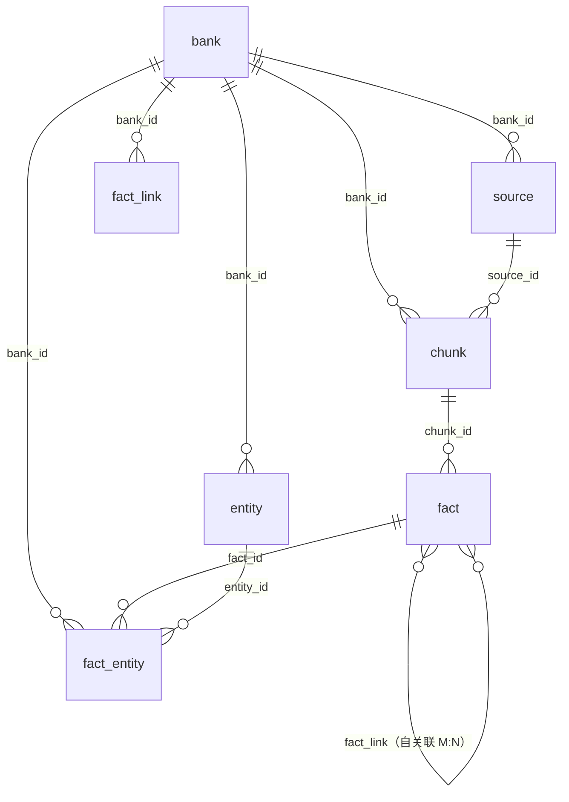

# memorybank 逻辑表结构设计（后端无关）

依据：docs/hindsight.pdf（HINDSIGHT 技术报告）。目标是用多种后端（关系型、嵌入式、混合）实现论文的四网络记忆模型，因此这里只定义**逻辑 schema**与约束，不绑定具体数据库的物理类型。

## 0. 总体设计决策

1. **四网络统一为一张 `fact` 表**。论文中记忆图 G=(V,E) 的 V 是"四个网络中全部事实行"的集合——opinion 和 observation 也是图节点（有自己的 embedding，参与建链、参与召回，opinion 强化时还要算 sim(v_o, v_f)）。按网络分表会让建链和召回逻辑翻倍。用 `fact_type` 列区分，并用条件约束表达网络特有字段。
2. **嵌入向量内联在 `fact` 行上**（仅 `embedding` 一列，`memory_embedding` 不单独设表）。原则：**契约承载数据，不承载索引**——BM25/GIN/区间索引均未进数据契约，向量亦然。每条事实恒有一个嵌入（可空=待生成/待回填），后端差异只在**加速方式**（原生 ANN 索引 / 行内 BLOB 暴力余弦 / 适配器内部侧表或外部向量库旁路），全部属于适配器实现自由，对核心逻辑不可见。bank 对嵌入模型采用**单世代假设**：激活模型是运行时配置，不落 schema——换模型即切代，全量向量置空后按新模型回填（见 §3.4 联动规则）。
3. **时间字段按论文双时间语义拆分**：τs/τe（事实**发生**区间，可空）与 τm（对话中**提及**时间）分开存储。
4. **fact_link 只物化"需预计算或 LLM 判断"的边；可由其他结构推导的邻接不落边表**：entity 邻接是 fact_entity 绑定的两两闭包——纯物化、对高连通实体 O(n²)，且重抽/合并/遗忘每条变更路径都要同步，故由遍历时经 fact_entity 推导，不落 fact_link。表内：temporal 无向双行（谓词对称：区间邻近；互逆两行成对写入、按对裁剪，规范键分组计行数恒 2 的库级不变量）；semantic/causal 有向单行——semantic 方向来自每个事实各自的 top-k 近邻预算（相似度对称、选择不对称），causal 是因果方向。方向语义由 link_type 推导，不设方向列。
5. **可追溯性是一等需求**（论文反复强调 traceability/audit）：溯源链为 `source(规范化全文+元数据) → chunk(无损切片) → fact(解释层)`，observation 重生成为**追加式**（新批插入即生效；一个观察可同属多个实体，不存在单值归属与替换集合；旧批由运行时 GC 回收，recall 按新近度取用）。意见的演化审计不在本 schema（见 §7.C）。
6. **后台调度不落库**（论文 4.1.5 Backend Processing 是异步*意图*）：观察合成触发、嵌入回填、链接重建等工作的 work list 全部由库内状态推导——NULL embedding 扫描、实体证据变更比对（例：e 的最新证据行 created_at 晚于其最新观察行 → 需重生成）、切代就地重建 semantic 边；调度器是运行时组件（内存队列/定期 sweep），进程崩溃丢失的内存调度由 sweep 收敛。chunk 抽取重试同理（chunk 行只持久化 status）。
7. **检索单元是事实行**。四路检索作用的对象是 `fact` 的四种表示（文本/BM25、向量、图、时间）；chunk 原文默认不进检索面（BM25 是否扩展到 chunk.text，见 §7）。
8. **接收即持久（事务性收件箱）**：source 行在一切处理开始前，先把规范化全文落库（`payload_text`）。此后分块、抽取的崩溃恢复全部以库内状态为起点，**不依赖调用方重传**。注：**非内核 WAL**——无 append-only 日志与增量重放，恢复 = 重扫持久状态 + 幂等重执行（§5.1）；原文清理/隐私姿态不在 schema 范围（§7.C）。
9. **幂等三级**：接收级=载荷已持久（不靠哈希）；分块级=`chunk.content_hash` 唯一索引，冲突即跳过（跨 source 共享材料归首个到达者，后到 source 为零 chunk 账本行）；抽取级=单 chunk 事务 + `status` 事务内翻转，失败由重扫重跑。`fact` 层**永不挂哈希**（LLM 转写文本非确定，不能作为去重键）。
10. **每表直接携带 `bank_id`**（含 chunk / fact_entity / fact_link）：它是**删除键与分区键**——"删 bank"=各表按 bank_id 一次索引区间删除（可并行、不依赖外键级联——FK 在非关系型后端可能不存在），并支撑 per-bank 分片与隔离。派生冗余但承重：按"换来索引或约束才落列"的标准成立。

## 1. 设计哲学与术语约定

### 1.1 数据皆为生成的解释层

`fact` 中的数据**归根到底是 LLM 提炼出来的，不是原始数据**。每一层都是从上一层"生成"的：

```
原始 utterance（调用方拥有；以 source/chunk 粒度随流程落库）
   → LLM 抽取 → 叙事事实（fact.text）        ← 第一次解释
   → LLM 合成 → 实体观察（observation）         ← 第二次解释
   → LLM 形成 → 意见 + 置信度（opinion）        ← 第三次解释
   → LLM 评估 → 置信度增减（强化）              ← 第四次解释
```

三条推论：

1. **bank 无原始数据可言，"客观"来自结构与审计，而非逐字复制**。world 网络的行也是转写；它的可信度由溯源链（fact → chunk → source）保证。
2. **转写 ≠ 概括**。抽取 prompt（论文 A.1）要求 MAXIMUM VERBOSITY、不省略任何细节，并在写入时解掉代词、归一化时间、展开指称——检索语料是"增强文本"（如 "she" → "Emily (the user's roommate)"），对检索比原文更友好。BM25 兜词法（专名/数字在转写中存活率最高），向量兜语义，实体链兜"措辞全变但身份相同"的情形；转写损耗的最后兜底是**诚实的空结果 → 弃答**，而不是像固定 top-k 的 RAG 那样用噪声上下文幻觉作答。
3. **重建能力取决于材料保留**：payload 与 chunk 切片随管线持久，可对存量 chunk 重跑抽取（崩溃重试、模型升级重抽）。原文清理属于部署层运维作业，schema 不含（§7.C）。

### 1.2 术语约定

| 论文用语 | 本设计 schema |
|---|---|
| memory unit / fact（泛指） f = (u, b, t, v, τs, τe, τm, ℓ, c, x) | `fact` 表的一行（**事实行**） |
| fact_type ℓ(f) | `fact.fact_type` 列 |
| 客观证据（W, B 网络） | fact_type ∈ {world, experience} 的行 |
| opinion o = (t, c, τ, b, E) | fact_type=opinion 的行（含 `confidence`） |
| observation（实体画像） | fact_type=observation 的行（实体绑定经 `fact_entity`，见 §3.6） |

行文纪律：行与表的统称是 `fact`/事实行——覆盖论文的 fact（其 memory unit）与全部 fact_type 取值；具体类型一律用 fact_type 值称呼（world 行 / experience 行 / opinion 行 / observation 行）；"记忆"一词仅用于域概念（agent 记忆、memory bank、记忆图），不再指代行。

### 1.3 准入判据（表 / 字段 / 边 / 缓存）

今后任何新表、新字段、新边、新缓存，先过以下检查：

1. **范围纪律**：论文机制（§7.A）优先实现；运营必需（§7.B）取精简形态；产品姿态与优化（§7.C）后置——范围外的东西不占 schema，记档在 §7.C。
2. **契约承载数据，不承载索引与策略**。判据：该值是否随**部署/实现**变化而非随**业务事实**变化？是 → 配置（运行时/适配器）；不是 → 列。例：嵌入模型、分块参数、重试节奏、建链阈值、ANN 加速方式全部在运行时；`fact.embedding` 数据本身在表。
3. **单一事实源**。判据：能否由**一次索引查询**从其他表/列推导？能 → 不落表。例：实体邻接 = `fact_entity` 的两两闭包（虚拟化，不落 `fact_link`）；指称变体 = `mention_text`（不设缓存别名表）。
4. **物化/派生冗余的准入**：必须换来至少一项——(a) 索引或唯一约束（如 `bank_id` 的删除/分区键、`chunk.content_hash`）；(b) 热路径显著成本节约且**有具名消费方**（如 `entity.mention_count` 供检索显著性、观察 staleness）；(c) 跨后端能力补齐。三样都换不来 → 删。反向测试：删掉它是否只是"查得慢一点/多一步"？是 → 删。
5. **租户与删除键显式化**：每表直接携带 `bank_id`；删除、分区、隔离不依赖 FK 级联或 join——FK 语义在多后端不保证。
6. **LLM 产物不可作幂等键**：哈希/去重只能落在字节稳定的层（载荷、切片）；生成文本（fact、观察、意见）**永不挂内容哈希**。

§0 中的具体决策是这些判据的**实例**；已被判据淘汰的构件及其回加路径记档在 §7.C。

## 2. 公共类型约定

| 逻辑类型 | 含义 | 关系型后端映射示例 | 嵌入式/其他后端 |
|---|---|---|---|
| `Id` | UUIDv7（时间有序，利于分页排序） | `UUID` | `TEXT`/`BLOB` |
| `TS` | UTC 时间戳，毫秒精度 | `timestamptz` | `INTEGER`(epoch ms) / `TEXT` |
| `Enum{a,b,c}` | 小写字符串枚举 | `TEXT` + CHECK 约束 | `TEXT` / `INTEGER` |
| `JSON` | 任意对象 | `jsonb` | `TEXT`/`BLOB` |
| `Vector<d>` | f32 定长向量，d 为配置的嵌入维度（`fact.embedding` 行内列） | `vector(d)` + 可选 HNSW | 行内 `BLOB`（暴力余弦）/ sqlite-vec / 适配器侧库 |
| `Float01` | [0,1] 区间浮点数 | `real` + CHECK | `REAL` |

外键标注 `→ 表.字段`。所有表自带 `created_at`/`updated_at`（下表不再重复列出；仅当某列语义特殊需要强调时，才显式列出）。

## 3. 表清单（核心 7 张）

### 3.1 `bank` — 记忆库容器 + 代理画像

**作用**：论文的 bank B，一个命名的容器，持有四网络数据和一个代理画像 P = (n, Θ, h)。一切数据都以 bank 为隔离边界。

| 字段 | 类型 | 说明 |
|---|---|---|
| `id` | `Id` PK | |
| `name` | `Text` UNIQUE | 容器名 n |
| `background` | `Text` | 第一人称背景 h；被 background merging（h' = MergeLLM(h, h_new)）持续改写 |
| `skepticism` | `Int` 1..5 | Θ.S 怀疑度（1=信任，5=怀疑） |
| `literalism` | `Int` 1..5 | Θ.L 字面度（1=灵活，5=逐字） |
| `empathy` | `Int` 1..5 | Θ.E 共情度（1=疏离，5=共情） |
| `bias_strength` | `Float01` | Θ.β 偏置强度（0=纯事实推理，1=强偏好条件化） |

### 3.2 `source` — 摄入账本 + 事务性收件箱（Retain 管线必需）

**作用**：论文的输入 D（会话转录/文档）。**接收即持久**：先把规范化全文落库，再异步分块/抽取；崩溃恢复的一切起点在此。幂等哈希不在此层（下沉到 chunk）。

| 字段 | 类型 | 说明 |
|---|---|---|
| `id` | `Id` PK | |
| `bank_id` | `Id` → bank.id | |
| `kind` | `Enum{transcript, document, message, api}` | |
| `title` | `Text` nullable | |
| `payload_text` | `Text` | 规范化全文：调用方载荷（transcript JSON / 文档）统一转换成的规范文本，分块在其上**无损切分**。接收事务(tx0)写入 |
| `status` | `Enum{received, chunked}` | received=已落库待分块（tx0 后）；chunked=分块完成（chunk 行落地或全被哈希跳过，tx1 后） |
| `created_at` | `TS` | 接收时刻（收件箱入账时间，tx0 写入）——本表显式列出，强调"接收即持久"的时间锚 |

索引：(bank_id, status)（重扫找待分块 source）。客户端重传同一载荷会产生"零 chunk 的 source 行"（账本残留，语义见 §5.1）。

### 3.3 `chunk` — 分块切片（核心：幂等单位 + 事务单位）

**作用**：抽取管线的消费单元，`source.payload_text` 的**无损切片**。摄入时（抽取前）先落库，是幂等与重放的锚：`content_hash` 负责跨 source 材料去重（"这段材料 bank 里有没有"），`status` 是抽取进度账本（"这段材料处理完没有"）。**单 chunk 事务** = 该 chunk 的全部事实产物一起原子落库（见 §5.1）。

| 字段 | 类型 | 说明 |
|---|---|---|
| `id` | `Id` PK | |
| `bank_id` | `Id` → bank.id | 租户/删除/分区键（§0.10）。取值必须等于 source.bank_id |
| `source_id` | `Id` → source.id | 归属摄入账本 |
| `chunk_index` | `Int` | 分块在 source 内的序号 |
| `text` | `Text` | verbatim 切片（payload_text 的无损子串） |
| `content_hash` | `Text` | text 的规范化哈希（哈希只对文本，不含 chunk_index）。**UNIQUE(bank_id, content_hash)**：冲突=材料已在 bank，跳过创建，材料与派生事实归属首个到达的 source |
| `status` | `Enum{pending, extracting, done, failed}` | pending=待抽取；extracting=已被 worker 认领（认领有效性以行 `updated_at` 年龄判定，过期即由重扫重置）；done=tx2 已提交；failed=死信态（运行时重试策略判定放弃后置入，可人工重置回 pending）。重试节奏/退避/放弃是运行时调度策略，**不落 schema** |
| `created_at` | `TS` | 分块落库时刻（tx1 写入），显式列出以锚定分块时钟（`updated_at` 仍按全局约定隐含，认领/状态翻转时刷新） |
| `time_start` / `time_end` | `TS` nullable | 该分块覆盖的对话时钟区间（调用方提供轮次时间戳时可得）；无自带时间的事实可由此默认 mentioned_at |

分块策略（配置项）：调用方提供会话/轮次元数据时**会话对齐优先**；纯文档按固定窗口（如 2–4k token）兜底。每块粗粒度抽取 2–5 条叙事事实（论文 4.1.2）。分块是确定性纯内存代码（读库内 payload），可任意崩溃重跑。分块参数属运行时配置，不落库（边界复现由部署侧持有配置）。

### 3.4 `fact` — 事实行（四网络统一表，核心表）

**作用**：论文的 memory unit——即本设计的事实行——f = (u, b, t, v, τs, τe, τm, ℓ, c, x)。四网络的行全部存这里，`fact_type` 列即论文的 fact_type ℓ(f)。注意：抽取管线只会产出 world/experience/opinion（论文 A.5.1 的枚举）；observation 只能由观察合成管线产生。

| 字段 | 类型 | 说明 |
|---|---|---|
| `id` | `Id` PK | u |
| `bank_id` | `Id` → bank.id | b，必填；删除/分区键（§0.10） |
| `fact_type` | `Enum{world, experience, opinion, observation}` | ℓ(f)，归属网络 |
| `text` | `Text` | t，叙事事实文本（LLM 转写）。BM25/全文检索的主语料、喂给 LLM 的内容、reranker 的输入 |
| `embedding` | `Vector<d>` nullable | v。NULL=待生成/待回填：tx2 优先写入，生成失败置 NULL，由运行时嵌入回填（扫描 `WHERE embedding IS NULL`）补齐；换模型切代时全量置 NULL 后按新模型回填。语义通道跳过 NULL 行（BM25 照常命中，词法先行窗口见 §5.4）；**永不做跨模型余弦比较** |
| `chunk_id` | `Id` nullable → chunk.id | 溯源：由哪个分块切片提炼而来（Retain 产出的行必有值）。verbatim 原文见 chunk/payload，不在此重复存储 |
| `occurred_start` | `TS` nullable | τs，发生区间起点 |
| `occurred_end` | `TS` nullable | τe，发生区间终点（=start 为点事件；NULL 为开放区间；均 NULL 为无时间信息） |
| `mentioned_at` | `TS` nullable | τm，对话中被提及的时间。用于时间衰减边、实体消解的 temporal proximity、"人类可读时间前缀"增强 |
| `confidence` | `Float01` nullable | c，belief strength。见下方条件约束 |
| `access_count` | `Int` default 0 | x.access_count：recall 命中时递增，可观测性/调参用 |
| `attrs` | `JSON` nullable | x 的其余部分：fact_kind、结构化地点等论文未定死字段 |

条件约束：

- `fact_type=opinion` 且 `chunk_id` 为空（reflect 产物）⇒ `confidence` NOT NULL；
- 由抽取直接产出的 opinion 行（chunk_id 有值，即对话里说出的意见）⇒ `confidence` 可空：论文未给抽取侧置信度（A.5.1 无此字段），可空行经强化机制逐步获得/修正（见 §7）。

> 说明：原设计曾在 fact 上设 `context` 列存逐条 verbatim 摘录，因"一个 chunk 提炼出多条事实、原文逐条冗余"被否决；verbatim 原文统一在 source/chunk 两层（payload 与切片），以 `chunk_id` 取代。
>
> 嵌入联动规则：`text` 被改写（意见 revise、重抽替换）⇒ 该行嵌入失效，须重嵌（事务内或运行时回填）；维度 d 与激活嵌入模型由 bank 运行时配置给定，**均不设列**——换模型 = 切代：全量 `embedding` 置 NULL，按新模型回填（`WHERE embedding IS NULL`），回填/新增之外的旧代行不参与语义通道，**任何时刻不跨模型比较**；语义通道在切代后只覆盖"新写入 + 已回填"的行（部分可用，RRF 四路缺一路贡献 0 分，正确性不破）；切代操作中**就地重建 semantic 边**（同样属运行时）；写入时校验向量字节长度与 d 一致，不符即拒。

### 3.5 `entity` — 规范化实体

**作用**：实体消解后的规范实体 E。论文定义 entity_type ∈ {PERSON, ORGANIZATION, LOCATION, PRODUCT, CONCEPT, OTHER}。每个 bank 内独立消解（bank 隔离）。

| 字段 | 类型 | 说明 |
|---|---|---|
| `id` | `Id` PK | |
| `bank_id` | `Id` → bank.id | 与 fact 同一隔离边界 |
| `canonical_name` | `Text` | 规范名（存前做 lowercase/trim 归一）。UNIQUE(bank_id, canonical_name)，防并发重复建实体 |
| `entity_type` | `Enum{person, organization, location, product, concept, other}` | |
| `mention_count` | `Int` default 0 | 物化计数：该实体在 fact_entity 中 **world/experience 绑定**的行数（"有多少事实证据行提到它"）。随绑定写删**同事务**增减；observation 绑定不计（派生行随追加/GC 漂移且构成自计数）、opinion 绑定不计（弱信号）。用途：检索显著性先验、取 Fe 规模预估 |
| `first_seen` / `last_seen` | `TS` nullable | 实体首次/最近被证据行提到的时间。按**对话时钟**（fact.mentioned_at，缺失时回退 fact.created_at），统计口径与 mention_count 相同（world/experience 绑定）、同事务维护。用途：实体活跃度/新鲜度、观察再生成的 staleness 判断 |
| `attrs` | `JSON` nullable | 消解过程信息（合并历史、得分等） |

> 统计维护规则：绑定写入/删除（A1 抽取落库、重抽替换）在同一事务内更新 mention_count 与 first_seen/last_seen；非严格事务的后端允许漂移，由重扫/维护作业收敛。

### 3.6 `fact_entity` — 事实 ↔ 实体（N:M）

**作用**：论文的事实抽取结果——规范实体集 E 的落地，同时是**实体邻接的物理来源**。它是四件事的数据基础：① 实体邻接的承载（共享实体的事实行集合的**两两闭包**由此推导，fact_link 不物化，遍历/扩散激活经绑定反查）；② 召回时按实体取 Fe、取观察画像批；③ opinion 强化时按实体重叠找候选（O_cand 判据一）；④ 观察重生成的绑定载体。

| 字段 | 类型 | 说明 |
|---|---|---|
| `bank_id` | `Id` → bank.id | 租户/删除/分区键（§0.10）。必须与两端 fact/entity 的 bank_id 一致 |
| `fact_id` | `Id` PK(复合) → fact.id | |
| `entity_id` | `Id` PK(复合) → entity.id | |
| `mention_text` | `Text` nullable | 抽取时的原始指称（如 "my roommate Emily"），消解特征与调试用；**实体消解的历史指称变体即由此提供**（不设缓存别名表，见 §7.C） |

**观察行的绑定语义**：observation 行同样建立**全量绑定**——生成目标实体（观察内容描述的实体，**可多个**）与文中提及的实体一视同仁，**不区分主体/提及**（"这行画像属于谁"是过程信息，不持久化）。检索语义上所有绑定同权：都参与实体邻接的推导、按实体召回与强化候选；新生成的观察批在 recall 中按 `created_at` 新近度优先，旧批由运行时 GC 回收（§5.3、§7）。

需要两个方向的索引：(fact_id) 和 (entity_id)。

### 3.7 `fact_link` — 记忆图的边

**作用**：记忆图的边存储。G=(V,E) 概念上含四类邻接，本表只物化其中的 temporal/semantic/causal——**entity 邻接不落本表**，它是 fact_entity 绑定的两两闭包，遍历时经绑定推导（§3.6）。方向语义由 link_type 推导，**不设方向列**：

| 字段 | 类型 | 说明 |
|---|---|---|
| `id` | `Id` PK | |
| `bank_id` | `Id` → bank.id | 租户/删除/分区键（§0.10）。必须与两端 fact 的 bank_id 一致 |
| `from_fact_id` | `Id` → fact.id | 有向边=选择/因果的发起侧 |
| `to_fact_id` | `Id` → fact.id | |
| `link_type` | `Enum{temporal, semantic, causal}` | 边类型 ℓ，决定行形态：**temporal=无向双行**；**semantic/causal=有向单行** |
| `relation` | `Enum{causes, caused_by, enables, prevents}` nullable | 仅 causal 边必填，方向语义由 relation 表达 |
| `weight` | `Float01` | causal=1.0（遍历时再用类型乘数 µ(ℓ) 上调）；temporal=exp(−Δt/σt)；semantic=cosine（≥θs 才建边） |

**行形态约定**：

- **无向双行（temporal）**：谓词对称（区间邻近），同一对节点存**互逆两行**——from→to 与 to→from，同事务成对插入、各带相同 weight。剪枝**按对生效**：某对被裁掉时两行都不存，保证"双行=完整成对"的不变量可在库中校验（规范键 (min(from,to), max(from,to), link_type) 分组计行数恒为 2；单侧行即异常）。
- **有向单行（semantic）**：cosine 相似度对称，但 **top-k 选择不对称**——每个事实各自选自己的近邻预算，B 的名额被更近者占满时，sim(A,B)=0.82 也可能只剩 A→B 一行（B→A 不存在，因为 B 没选 A）。边的语义因此是"**A 把 B 选进了自己的近邻预算**"，不宣称互惠；是否存在 B→A 由 B 自己的选择决定。邻接读取永远单方向 `WHERE from_fact_id = N`。
- **有向单行（causal）**：因→果方向单行，因果谓词由 relation 表达。
- **实体邻接不在本表**：两 fact 共享同一实体的邻接由 fact_entity 绑定推导——遍历/扩散激活经绑定反查同实体事实行，weight 恒 1.0、µ(entity) 规则不变；两两闭包物化的代价是 O(n²)（高连通实体为主）且重抽/合并/遗忘每条变更路径都要同步，故不落。
- 重入判重：temporal 按规范键 (min(from,to), max(from,to), link_type)；semantic/causal 按 (from, to, link_type)——互惠边（A→B 与 B→A）是独立两行，可并存也可只有其一。

唯一约束 (from_fact_id, to_fact_id, link_type, relation)。建链阈值（σt、θs、top-k 预算、邻居上限等）是配置参数，不落库——这张表只存"最终决定保留的边"（避免 V² 级边数，需在建链期剪枝）。

## 4. 表关系



要点：

- **bank 是所有数据的租户边界，每张表都直接携带 `bank_id`（§0.10）**："删 bank" = 各表按 bank_id 的索引区间删除（可并行），不依赖外键级联；跨表引用（fact_link 两端、fact_entity 两端）写入时校验同 bank。全局约定：所有表（bank 自身除外）的 `bank_id` 建索引。
- **三层溯源链**：source（账本：元数据 + 规范化全文）→ chunk（无损切片材料）→ fact（生成的解释层）。原文在库中共两份（payload 与切片之和，×2），是收件箱与幂等重放所必需；fact 不重复存原文，`chunk_id` 是唯一锚点。跨 source 命中同一 chunk 哈希时**不建重复材料行**——材料与派生事实永远单一归属。
- **fact ↔ entity 是 N:M**（`fact_entity`；对 fact 侧即多对一：一条事实多行绑定）。observation 行同样走此绑定，生成目标实体与文中提及实体不区分（主体是过程信息，不持久化）；重生成为追加式，旧批由运行时 GC 回收（§5.3）。
- **fact ↔ fact 自关联**只剩一组：`fact_link`（图的边，M:N）。observation 重生成为**追加式**（新批插入即生效，无版本链；旧批由运行时 GC 回收）。

## 5. 数据流：写入与读取

### 5.1 摄入管线（收件箱四段）与崩溃恢复

```
① tx0 接收：调用方载荷 → 规范化文本 → insert source(payload_text, status=received)
        ── 此处即可 ack（异步契约）或继续同步推进
② 分块（确定性纯内存代码，读库内 payload；任意崩溃可重跑）
   tx1：insert 全部 chunk 行（text + content_hash + status=pending）
        每行 ON CONFLICT(bank_id, content_hash) → 跳过（材料已在 bank）
        + source.status → chunked（同事务）
③ 逐 chunk 抽取（同步推进或 worker 推进）：
   事务外：LLM 抽取 / Assess / embedding 等多模型调用
   tx2：该 chunk 全部事实产物（fact（嵌入一并写入）+ fact_entity
        + entity + fact_link + 既有 opinion 的置信度增量）+ chunk.status pending→done
        （原子认领：UPDATE … WHERE status='pending'，0 行命中则他人已完成→回滚放弃）
④ 重扫（启动/周期）：
   source.status=received → 补分块（重跑 tx1）
   chunk.status=pending，或 extracting 但 updated_at 已过期 → 重跑③
   （重试节奏/退避/是否放弃（置 failed）由运行时调度决定，不落库）
```

| 级 | 崩溃时点 | 恢复 | 幂等保证 |
|---|---|---|---|
| 接收 | tx0 提交前 | 调用方重传（唯一不可消除的窗口：库还没收到字节） | tx0 原子；重传后旧载荷被哈希跳过，新 source 为零 chunk 账本行 |
| 分块 | tx1 前后 | 重扫补分块 | chunk 哈希唯一索引，冲突=跳过 |
| 抽取 | 事务外（多模型调用）或 tx2 | chunk 停在 pending/extracting，重扫重跑 | 状态原子认领 + 事务整体回滚；α 增量在事务内，不会重复施加 |

**跨 source 共享 chunk 的语义**：后到 source 命中全部 chunk 哈希时，成为"零 chunk 的 source 行"（账本记一笔"见过"；不建重复 chunk、不复制文本、不重抽）。重传合并策略见 §7。

**重抽（update 模式）**：模型升级等场景对存量 chunk 重跑抽取 = 事务内 delete 该 chunk 旧事实及出边 + insert 新事实 + 翻状态。已吸收进意见的强化增量**不回滚**（记档）。

### 5.2 结构化输出 → 列映射（source 与 fact 之间的转换契约）

| ExtractedFact 字段（论文 A.5.1） | 落到 |
|---|---|
| 五维（what/when/where/who/why）织成一段完整叙事 | `fact.text` |
| fact_type | `fact.fact_type`（world/experience/opinion） |
| occurred_start / occurred_end（归一化绝对时间） | `fact.occurred_start / occurred_end` |
| mentioned_at | `fact.mentioned_at` |
| entities[]（mention 列表） | `fact_entity`（mention → 消解到规范 entity） |
| causal_relations[]（块内事实行间因果） | `fact_link`（link_type=causal） |

### 5.3 五条生成/更新路径与各表的落点

| 路径 | 触发 | 新增行 | 修改行 |
|---|---|---|---|
| A0. 接收与分块（收件箱前两段） | 调用方灌入 D | source(payload)、chunk(text+hash, status=pending；哈希冲突者跳过) | source.status→chunked |
| A1. Retain 抽取（单 chunk 事务；A2/A3 同事务内落库） | 分块落地后（同步或重扫） | fact(world/experience，及抽取产出的 opinion；嵌入一并写入), fact_entity, entity, fact_link | chunk.status→done；既有 opinion 的 confidence/text |
| A2. 意见强化 | A1 事务内（Assess 在事务外） | — | fact.confidence(c±α)、可能 text |
| A3. 背景合并 | Retain 遇 biographical 信息（MergeLLM 在事务外） | — | bank.background |
| B. Reflect 形成意见 | 带 query 的应答 | fact(opinion，嵌入一并写入), fact_entity | — |
| C. 观察后台合成 | 实体触及新事实（调度属运行时：内存队列或定期 sweep，work list 由状态推导——如 e 的最新证据行 created_at 晚于其最新观察行） | fact(observation，嵌入一并写入) + 其全量 fact_entity 绑定 | —（追加式，无破坏性替换；旧批由运行时 GC 按龄/计数上限回收，recall 按新近度取用） |
| D. 程序化直写（未定，论文无） | 应用显式写入 | 视 API | — |

### 5.4 读路径（Recall 四通道）与不产出事实的环节

| 通道 | 数据来源 |
|---|---|
| 语义（向量） | `fact.embedding`（由事实行文本 + 人类可读时间前缀生成；ANN 索引与否是适配器实现自由，核心只见取值与过滤扫描） |
| 关键词（BM25） | `fact.text`（是否同时覆盖 `chunk.text` 作 verbatim 兜底，见 §7） |
| 图扩散 | `fact_link` + `fact_entity`（从语义命中顶点出发激活） |
| 时间过滤 | `fact.occurred_*` / `mentioned_at` 区间匹配 |

RRF 融合、交叉编码器重排、token 预算打包全部内存内完成，不落库；命中后 `fact.access_count`++。**明确不产生事实数据的环节**：Recall 四通道（除 access_count）、RRF/重排、背景合并（只改 bank.background）。

### 5.5 时间刻度

同一行数据的三个时钟各管一摊：摄入时刻（source/chunk 的 created_at）、对话时钟（`mentioned_at`、chunk.time_start/end）、事件时钟（`occurred_*`）。recall 的时间过滤用事件时钟；时间衰减边与消解的 temporal proximity 用对话时钟。

## 6. 后端适配提示

| 能力 | 关系型(PG) | 嵌入式(SQLite 类) | 其他 |
|---|---|---|---|
| 向量检索加速（适配器实现自由，核心不可见） | pgvector：列类型 `vector` + HNSW | 行内 BLOB + 暴力余弦 / sqlite-vec / 内存 HNSW（usearch） | 外部向量库旁路（适配器内部物化副本，键挂 fact.id） |
| BM25/FTS | GIN + tsvector / pg_trgm | FTS5 | 外部索引；兜底 LIKE（牺牲质量） |
| 时间区间重叠 | tstzrange + GiST | occurred_start/occurred_end 双索引 + 过滤 | 同左 |
| 图遍历 | 递归 CTE / 自连接（无向边双行、有向单行；实体邻接经 fact_entity 连接推导） | 同左 | 图库旁路 |
| JSON | jsonb | TEXT | 结构化展开 |
| 幂等三级 | 接收=载荷持久；分块=唯一索引 + ON CONFLICT 跳过；抽取=单 chunk 事务内状态翻转（乐观认领） | 同左（复合唯一索引 + UPSERT） | 无约束后端以预检 + 重扫兜底 |

## 7. 留给实现阶段拍板的点

排期原则：先实现论文中有的内容。三档标注——**A 论文机制**（必须实现）/**B 运营必需**（论文没有，没有它系统跑不起来）/**C 论文范围外**（后置）。

### A 档 · 论文机制（首批实现）

1. 嵌入输入 = 存储文本 + 人类可读时间前缀，且**存增强后的完整文本**（各链路为同一字符串）；reranker 输入同理带时间（论文 4.1.2）。
2. 抽取产出的 opinion 行 `confidence` 可空的约定（论文 A.5.1 无抽取侧置信度字段）——是否认可，或由抽取 prompt 让其给出初始置信度。
3. 分块策略：会话对齐优先 / 窗口兜底 / 窗口大小可配置（论文 4.1.2 粗粒度分块，每块 2–5 条叙事事实）。
4. `access_count` 保留与否（论文机制 x.access_count；写放大 vs 可观测性）。
5. 意见形成时刻 τ 用 `created_at` 表达；若后续出现意见 revise 但需保留原形成时间，再加专列。
6. 观察粒度：每实体一次生成 3–7 条、每条一行（本设计采用）还是整块画像一行。

### B 档 · 运营必需（收件箱/幂等/恢复，初版可取精简形态）

8. 接收契约初版：建议**纯同步**（retain 阻塞至全部 chunk done）；tx0 即 ack / 异步 worker 推进后置。
9. 观察合成的调度与 GC：调度为运行时职责（内存队列或定期 sweep；work list 由库内状态推导——实体证据变更比对）；初版可同步生成于 retain 内、可不 GC；崩溃丢失的内存调度由 sweep 收敛。

### C 档 · 论文范围外（后置）

10. chunk 层 BM25 兜底（verbatim 语料；注意同 chunk 兄弟行会在单列表扎堆，RRF 多列表机制可缓解）。
11. 程序化直写 API（路径 D）——影响 API 面与幂等语义。
12. fact 行内细粒度引文列 `quote`（chunk 已承担 verbatim 职责）。
13. 按来源遗忘/引用计数式软删；重抽模式不回滚已吸收的强化增量（论文 future work：controlled forgetting / privacy-aware memory management）。
14. 原文存储 ×2（payload + 切片）的字符区间派生优化；客户端重传产生的零 chunk source 行的合并策略：调用方按 retain 返回的 source id 自行管理标识与归组（schema 不承载调用方命名）。
15. 隐私/材料清理：论文无此机制；收件箱模式下原文在库；需要时由部署层运维作业清空 `source.payload_text` 与 `chunk.text` 文本列（结构行与哈希保留，幂等键不失效）——无需 schema 支持。
16. 实体指称变体缓存（entity_alias）：已从 schema 移除；消解变体由 `fact_entity.mention_text` 推导（精确路径走 `entity.canonical_name` 索引直达，未命中路径按候选实体聚合绑定行，调用内可内存缓存）。大规模部署若未命中路径聚合变慢，按需再物化缓存表——纯加法。
17. 意见演化审计表（opinion_history）：已从 schema 移除；confidence 原地更新（c±α），强化幂等由"单 chunk 事务整体回滚 + 证据行生命周期"近似保证，无判重锚（运维级重放需自慎）。若后续需要意见轨迹审计（论文 5.7 的演化示例、controlled forgetting 底座），后置加表——结构已备：event(formed/reinforced/weakened/contradicted/revised)、old/new_confidence、trigger_fact_id、reason，可再补 old_text 记录改写前的表述。
18. 持久化任务队列（background_task）：已移除——后台工作的 work list 可由库内状态推导（embedding NULL 扫描、实体证据变更比对、切代就地重建 semantic 边），调度归运行时组件。若将来需要跨进程可靠分发/优先级/精确重试语义，按需再加表（结构现成：task_type / payload / status / attempts / run_after）。